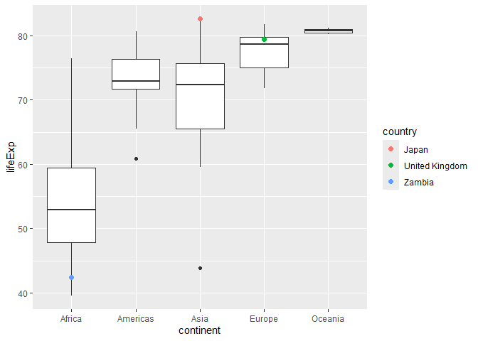
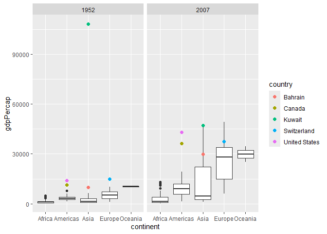
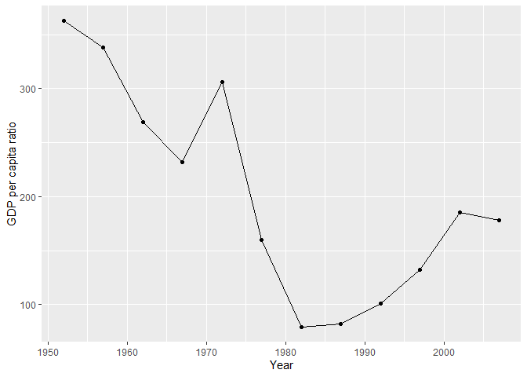
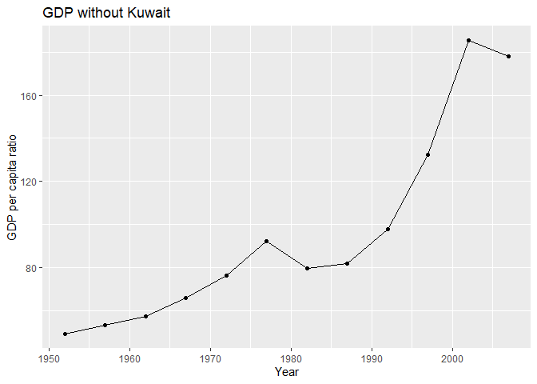
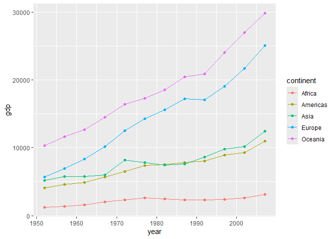
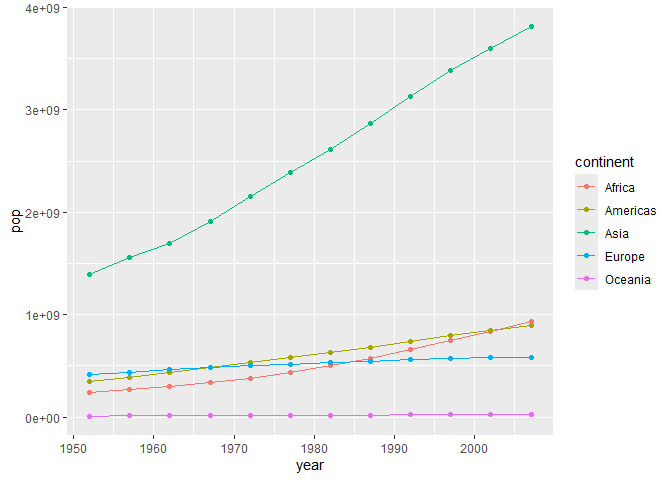
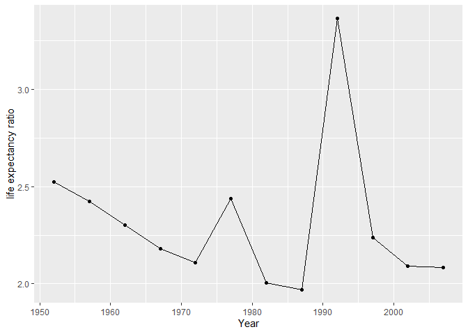
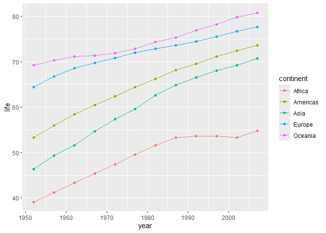

Gapminder
================
(Your name here)
2020-

- [Grading Rubric](#grading-rubric)
  - [Individual](#individual)
  - [Submission](#submission)
- [Guided EDA](#guided-eda)
  - [**q0** Perform your “first checks” on the dataset. What variables
    are in
    this](#q0-perform-your-first-checks-on-the-dataset-what-variables-are-in-this)
  - [**q1** Determine the most and least recent years in the `gapminder`
    dataset.](#q1-determine-the-most-and-least-recent-years-in-the-gapminder-dataset)
  - [**q2** Filter on years matching `year_min`, and make a plot of the
    GDP per capita against continent. Choose an appropriate `geom_` to
    visualize the data. What observations can you
    make?](#q2-filter-on-years-matching-year_min-and-make-a-plot-of-the-gdp-per-capita-against-continent-choose-an-appropriate-geom_-to-visualize-the-data-what-observations-can-you-make)
  - [**q3** You should have found *at least* three outliers in q2 (but
    possibly many more!). Identify those outliers (figure out which
    countries they
    are).](#q3-you-should-have-found-at-least-three-outliers-in-q2-but-possibly-many-more-identify-those-outliers-figure-out-which-countries-they-are)
  - [**q4** Create a plot similar to yours from q2 studying both
    `year_min` and `year_max`. Find a way to highlight the outliers from
    q3 on your plot *in a way that lets you identify which country is
    which*. Compare the patterns between `year_min` and
    `year_max`.](#q4-create-a-plot-similar-to-yours-from-q2-studying-both-year_min-and-year_max-find-a-way-to-highlight-the-outliers-from-q3-on-your-plot-in-a-way-that-lets-you-identify-which-country-is-which-compare-the-patterns-between-year_min-and-year_max)
- [Your Own EDA](#your-own-eda)
  - [**q5** Create *at least* three new figures below. With each figure,
    try to pose new questions about the
    data.](#q5-create-at-least-three-new-figures-below-with-each-figure-try-to-pose-new-questions-about-the-data)

*Purpose*: Learning to do EDA well takes practice! In this challenge
you’ll further practice EDA by first completing a guided exploration,
then by conducting your own investigation. This challenge will also give
you a chance to use the wide variety of visual tools we’ve been
learning.

<!-- include-rubric -->

# Grading Rubric

<!-- -------------------------------------------------- -->

Unlike exercises, **challenges will be graded**. The following rubrics
define how you will be graded, both on an individual and team basis.

## Individual

<!-- ------------------------- -->

| Category | Needs Improvement | Satisfactory |
|----|----|----|
| Effort | Some task **q**’s left unattempted | All task **q**’s attempted |
| Observed | Did not document observations, or observations incorrect | Documented correct observations based on analysis |
| Supported | Some observations not clearly supported by analysis | All observations clearly supported by analysis (table, graph, etc.) |
| Assessed | Observations include claims not supported by the data, or reflect a level of certainty not warranted by the data | Observations are appropriately qualified by the quality & relevance of the data and (in)conclusiveness of the support |
| Specified | Uses the phrase “more data are necessary” without clarification | Any statement that “more data are necessary” specifies which *specific* data are needed to answer what *specific* question |
| Code Styled | Violations of the [style guide](https://style.tidyverse.org/) hinder readability | Code sufficiently close to the [style guide](https://style.tidyverse.org/) |

## Submission

<!-- ------------------------- -->

Make sure to commit both the challenge report (`report.md` file) and
supporting files (`report_files/` folder) when you are done! Then submit
a link to Canvas. **Your Challenge submission is not complete without
all files uploaded to GitHub.**

``` r
library(tidyverse)
```

    ## ── Attaching core tidyverse packages ──────────────────────── tidyverse 2.0.0 ──
    ## ✔ dplyr     1.2.1     ✔ readr     2.2.0
    ## ✔ forcats   1.0.1     ✔ stringr   1.6.0
    ## ✔ ggplot2   4.0.3     ✔ tibble    3.3.1
    ## ✔ lubridate 1.9.5     ✔ tidyr     1.3.2
    ## ✔ purrr     1.2.2     
    ## ── Conflicts ────────────────────────────────────────── tidyverse_conflicts() ──
    ## ✖ dplyr::filter() masks stats::filter()
    ## ✖ dplyr::lag()    masks stats::lag()
    ## ℹ Use the conflicted package (<http://conflicted.r-lib.org/>) to force all conflicts to become errors

``` r
library(gapminder)
lm
```

    ## function (formula, data, subset, weights, na.action, method = "qr", 
    ##     model = TRUE, x = FALSE, y = FALSE, qr = TRUE, singular.ok = TRUE, 
    ##     contrasts = NULL, offset, ...) 
    ## {
    ##     ret.x <- x
    ##     ret.y <- y
    ##     cl <- match.call()
    ##     mf <- match.call(expand.dots = FALSE)
    ##     m <- match(c("formula", "data", "subset", "weights", "na.action", 
    ##         "offset"), names(mf), 0L)
    ##     mf <- mf[c(1L, m)]
    ##     mf$drop.unused.levels <- TRUE
    ##     mf[[1L]] <- quote(stats::model.frame)
    ##     mf <- eval(mf, parent.frame())
    ##     if (method == "model.frame") 
    ##         return(mf)
    ##     else if (method != "qr") 
    ##         warning(gettextf("method = '%s' is not supported. Using 'qr'", 
    ##             method), domain = NA)
    ##     mt <- attr(mf, "terms")
    ##     y <- model.response(mf, "numeric")
    ##     w <- as.vector(model.weights(mf))
    ##     if (!is.null(w) && !is.numeric(w)) 
    ##         stop("'weights' must be a numeric vector")
    ##     offset <- model.offset(mf)
    ##     mlm <- is.matrix(y)
    ##     ny <- if (mlm) 
    ##         nrow(y)
    ##     else length(y)
    ##     if (!is.null(offset)) {
    ##         if (!mlm) 
    ##             offset <- as.vector(offset)
    ##         if (NROW(offset) != ny) 
    ##             stop(gettextf("number of offsets is %d, should equal %d (number of observations)", 
    ##                 NROW(offset), ny), domain = NA)
    ##     }
    ##     if (is.empty.model(mt)) {
    ##         x <- NULL
    ##         z <- list(coefficients = if (mlm) matrix(NA_real_, 0, 
    ##             ncol(y)) else numeric(), residuals = y, fitted.values = 0 * 
    ##             y, weights = w, rank = 0L, df.residual = if (!is.null(w)) sum(w != 
    ##             0) else ny)
    ##         if (!is.null(offset)) {
    ##             z$fitted.values <- offset
    ##             z$residuals <- y - offset
    ##         }
    ##     }
    ##     else {
    ##         x <- model.matrix(mt, mf, contrasts)
    ##         z <- if (is.null(w)) 
    ##             lm.fit(x, y, offset = offset, singular.ok = singular.ok, 
    ##                 ...)
    ##         else lm.wfit(x, y, w, offset = offset, singular.ok = singular.ok, 
    ##             ...)
    ##     }
    ##     class(z) <- c(if (mlm) "mlm", "lm")
    ##     z$na.action <- attr(mf, "na.action")
    ##     z$offset <- offset
    ##     z$contrasts <- attr(x, "contrasts")
    ##     z$xlevels <- .getXlevels(mt, mf)
    ##     z$call <- cl
    ##     z$terms <- mt
    ##     if (model) 
    ##         z$model <- mf
    ##     if (ret.x) 
    ##         z$x <- x
    ##     if (ret.y) 
    ##         z$y <- y
    ##     if (!qr) 
    ##         z$qr <- NULL
    ##     z
    ## }
    ## <bytecode: 0x0000023b64c139d8>
    ## <environment: namespace:stats>

*Background*: [Gapminder](https://www.gapminder.org/about-gapminder/) is
an independent organization that seeks to educate people about the state
of the world. They seek to counteract the worldview constructed by a
hype-driven media cycle, and promote a “fact-based worldview” by
focusing on data. The dataset we’ll study in this challenge is from
Gapminder.

# Guided EDA

<!-- -------------------------------------------------- -->

First, we’ll go through a round of *guided EDA*. Try to pay attention to
the high-level process we’re going through—after this guided round
you’ll be responsible for doing another cycle of EDA on your own!

### **q0** Perform your “first checks” on the dataset. What variables are in this

dataset?

``` r
## TASK: Do your "first checks" here!
glimpse(gapminder)
```

    ## Rows: 1,704
    ## Columns: 6
    ## $ country   <fct> "Afghanistan", "Afghanistan", "Afghanistan", "Afghanistan", …
    ## $ continent <fct> Asia, Asia, Asia, Asia, Asia, Asia, Asia, Asia, Asia, Asia, …
    ## $ year      <int> 1952, 1957, 1962, 1967, 1972, 1977, 1982, 1987, 1992, 1997, …
    ## $ lifeExp   <dbl> 28.801, 30.332, 31.997, 34.020, 36.088, 38.438, 39.854, 40.8…
    ## $ pop       <int> 8425333, 9240934, 10267083, 11537966, 13079460, 14880372, 12…
    ## $ gdpPercap <dbl> 779.4453, 820.8530, 853.1007, 836.1971, 739.9811, 786.1134, …

``` r
summary(gapminder)
```

    ##         country        continent        year         lifeExp     
    ##  Afghanistan:  12   Africa  :624   Min.   :1952   Min.   :23.60  
    ##  Albania    :  12   Americas:300   1st Qu.:1966   1st Qu.:48.20  
    ##  Algeria    :  12   Asia    :396   Median :1980   Median :60.71  
    ##  Angola     :  12   Europe  :360   Mean   :1980   Mean   :59.47  
    ##  Argentina  :  12   Oceania : 24   3rd Qu.:1993   3rd Qu.:70.85  
    ##  Australia  :  12                  Max.   :2007   Max.   :82.60  
    ##  (Other)    :1632                                                
    ##       pop              gdpPercap       
    ##  Min.   :6.001e+04   Min.   :   241.2  
    ##  1st Qu.:2.794e+06   1st Qu.:  1202.1  
    ##  Median :7.024e+06   Median :  3531.8  
    ##  Mean   :2.960e+07   Mean   :  7215.3  
    ##  3rd Qu.:1.959e+07   3rd Qu.:  9325.5  
    ##  Max.   :1.319e+09   Max.   :113523.1  
    ## 

``` r
gapminder
```

    ## # A tibble: 1,704 × 6
    ##    country     continent  year lifeExp      pop gdpPercap
    ##    <fct>       <fct>     <int>   <dbl>    <int>     <dbl>
    ##  1 Afghanistan Asia       1952    28.8  8425333      779.
    ##  2 Afghanistan Asia       1957    30.3  9240934      821.
    ##  3 Afghanistan Asia       1962    32.0 10267083      853.
    ##  4 Afghanistan Asia       1967    34.0 11537966      836.
    ##  5 Afghanistan Asia       1972    36.1 13079460      740.
    ##  6 Afghanistan Asia       1977    38.4 14880372      786.
    ##  7 Afghanistan Asia       1982    39.9 12881816      978.
    ##  8 Afghanistan Asia       1987    40.8 13867957      852.
    ##  9 Afghanistan Asia       1992    41.7 16317921      649.
    ## 10 Afghanistan Asia       1997    41.8 22227415      635.
    ## # ℹ 1,694 more rows

**Observations**:

- country, continent, year, lifeExp, pop, gdpPercap

### **q1** Determine the most and least recent years in the `gapminder` dataset.

*Hint*: Use the `pull()` function to get a vector out of a tibble.
(Rather than the `$` notation of base R.)

``` r
## TASK: Find the largest and smallest values of `year` in `gapminder`
year_max <- gapminder %>%
  pull(year) %>%
  max()
year_min <- gapminder %>%
  pull(year) %>%
  min()
#sum(gapminder$country == "Mongolia")
```

Use the following test to check your work.

``` r
## NOTE: No need to change this
assertthat::assert_that(year_max %% 7 == 5)
```

    ## [1] TRUE

``` r
assertthat::assert_that(year_max %% 3 == 0)
```

    ## [1] TRUE

``` r
assertthat::assert_that(year_min %% 7 == 6)
```

    ## [1] TRUE

``` r
assertthat::assert_that(year_min %% 3 == 2)
```

    ## [1] TRUE

``` r
if (is_tibble(year_max)) {
  print("year_max is a tibble; try using `pull()` to get a vector")
  assertthat::assert_that(False)
}

print("Nice!")
```

    ## [1] "Nice!"

### **q2** Filter on years matching `year_min`, and make a plot of the GDP per capita against continent. Choose an appropriate `geom_` to visualize the data. What observations can you make?

You may encounter difficulties in visualizing these data; if so document
your challenges and attempt to produce the most informative visual you
can.

``` r
## TASK: Create a visual of gdpPercap vs continent
gapminder %>%
  filter(year == year_min) %>%
  ggplot(aes(x = continent, y = gdpPercap)) +
  geom_point()
```

<!-- -->

``` r
gapminder %>%
  filter(year == year_min) %>%
  ggplot(aes(x = continent, y = gdpPercap)) +
  geom_boxplot()
```

<!-- -->

**Observations**:

- Most of the GDPpercapit’s data points are concentrated, particularly
  in Oceania. There are several high outliers in the Americas, Europe,
  and Asia. Among these regions, a outlier in Asia are particularly
  notable. The lowest median of GDPpercapita is Afraica and highest is
  the Oceania.

**Difficulties & Approaches**: - In some continents, the gap in
GDPpercapita is much bigger than others, and it’s hard to idenify which
countries. And the outlier of Asia could affect the average trend if use
the line graph.  
- The box plot is easier to compare distribution of different continents
and identify value like Median and outliers.

### **q3** You should have found *at least* three outliers in q2 (but possibly many more!). Identify those outliers (figure out which countries they are).

``` r
## TASK: Identify the outliers from q2
gapminder %>%
  filter(year == year_min) %>%
  arrange(desc(gdpPercap))
```

    ## # A tibble: 142 × 6
    ##    country        continent  year lifeExp       pop gdpPercap
    ##    <fct>          <fct>     <int>   <dbl>     <int>     <dbl>
    ##  1 Kuwait         Asia       1952    55.6    160000   108382.
    ##  2 Switzerland    Europe     1952    69.6   4815000    14734.
    ##  3 United States  Americas   1952    68.4 157553000    13990.
    ##  4 Canada         Americas   1952    68.8  14785584    11367.
    ##  5 New Zealand    Oceania    1952    69.4   1994794    10557.
    ##  6 Norway         Europe     1952    72.7   3327728    10095.
    ##  7 Australia      Oceania    1952    69.1   8691212    10040.
    ##  8 United Kingdom Europe     1952    69.2  50430000     9980.
    ##  9 Bahrain        Asia       1952    50.9    120447     9867.
    ## 10 Denmark        Europe     1952    70.8   4334000     9692.
    ## # ℹ 132 more rows

``` r
gapminder %>%
  filter(year == year_min) %>%
  arrange(gdpPercap)
```

    ## # A tibble: 142 × 6
    ##    country           continent  year lifeExp       pop gdpPercap
    ##    <fct>             <fct>     <int>   <dbl>     <int>     <dbl>
    ##  1 Lesotho           Africa     1952    42.1    748747      299.
    ##  2 Guinea-Bissau     Africa     1952    32.5    580653      300.
    ##  3 Eritrea           Africa     1952    35.9   1438760      329.
    ##  4 Myanmar           Asia       1952    36.3  20092996      331 
    ##  5 Burundi           Africa     1952    39.0   2445618      339.
    ##  6 Ethiopia          Africa     1952    34.1  20860941      362.
    ##  7 Cambodia          Asia       1952    39.4   4693836      368.
    ##  8 Malawi            Africa     1952    36.3   2917802      369.
    ##  9 Equatorial Guinea Africa     1952    34.5    216964      376.
    ## 10 China             Asia       1952    44   556263527      400.
    ## # ℹ 132 more rows

**Observations**:

- the boxplot of q2 show that most of the outliers tend to have high
  value, So I sorted the the GdpPerCapita from highest to lowest to find
  the outliers. The table show the most significant outlier of the
  boxplot belong to Kuwait in Asia is 108382.3529, followed by
  Switzerland in Europe is 14734.2327, United States in American is
  13990.4821, and Canada in Americans is 11367.1611. Among those
  countries, the United Staten’s population is much higher than others
  in 1952.

  *Hint*: For the next task, it’s helpful to know a ggplot trick we’ll
  learn in an upcoming exercise: You can use the `data` argument inside
  any `geom_*` to modify the data that will be plotted *by that geom
  only*. For instance, you can use this trick to filter a set of points
  to label:

``` r
## NOTE: No need to edit, use ideas from this in q4 below
gapminder %>%
  filter(year == max(year)) %>%

  ggplot(aes(continent, lifeExp)) +
  geom_boxplot() +
  geom_point(
    data = . %>% filter(country %in% c("United Kingdom", "Japan", "Zambia")),
    mapping = aes(color = country),
    size = 2
  )
```

<!-- -->

### **q4** Create a plot similar to yours from q2 studying both `year_min` and `year_max`. Find a way to highlight the outliers from q3 on your plot *in a way that lets you identify which country is which*. Compare the patterns between `year_min` and `year_max`.

*Hint*: We’ve learned a lot of different ways to show multiple
variables; think about using different aesthetics or facets.

``` r
## TASK: Create a visual of gdpPercap vs continent
gapminder %>%
  filter(year == year_min | year == year_max) %>% 
  ggplot(aes(continent, gdpPercap)) +
  geom_boxplot() +
  geom_point(
    data = . %>% filter(country %in% c("United States", "Kuwait", "Switzerland", "Canada","Bahrain")),
    mapping = aes(color = country),
    size = 2
  ) +
  facet_wrap(~year)
```

<!-- -->

**Observations**:

- The GDP per capita (gdpPercap) is more widely spread across the
  continents in 2007, and most countries experienced an increase in GDP
  per capita. In the Americas, Canada and the United States appear as
  further outliers then 1952. In Asia, Kuwait was an extreme outlier,
  its GDP per capita decreased a lot compared with previous years, but
  it still had the highest GDP per capita in Asia. Bahrain and
  Switzerland are not classified as outliers in 2007, but their GDP per
  capita values are still above the upper quartile of their continent
  distributions.

# Your Own EDA

<!-- -------------------------------------------------- -->

Now it’s your turn! We just went through guided EDA considering the GDP
per capita at two time points. You can continue looking at outliers,
consider different years, repeat the exercise with `lifeExp`, consider
the relationship between variables, or something else entirely.

### **q5** Create *at least* three new figures below. With each figure, try to pose new questions about the data.

``` r
## TASK: Your first graph
gapminder %>%
  group_by(year) %>%
  summarise(
    high = max(gdpPercap),
    low = min(gdpPercap),
    r = high / low
    ) %>%
  ggplot(aes(x = year, y = r)) +
  geom_line() +
  geom_point() +
  labs(
    x = "Year",
    y = "GDP per capita ratio",
  )
```

<!-- --> -
This graph shows the ratio between the highest and lowest GDP per capita
every five years from 1952 to 2007, allowing us to observe how the
Wealth gap of countries changes over time. The GDP ratio flow over time
and do not follow a single trend like the first graph, It decrease and
increase and seem like affected by some factor. The ratio start very
high in 1952, and reach other peak around 1972 then decrease sharply to
the low point around 1987. It increase after it and decrease at the end.

``` r
gapminder %>%
  group_by(year) %>%
  filter(country != "Kuwait") %>%
  summarise(
    high = max(gdpPercap),
    low = min(gdpPercap),
    r = high / low
    ) %>%
  ggplot(aes(x = year, y = r)) +
  geom_line() +
  geom_point() +
  labs(
    x = "Year",
    y = "GDP per capita ratio",
    title= "GDP without Kuwait"
  )
```

<!-- --> -
The first box plot from q1 show there is a extreme outlier Kuwait exist
in Asia. It would impact a lot with the GDP ratio graph because it
calculated only by the highest and lowest GDP per capita. This graph
show the GDP per Capita ratio trend without Kuwait. and it show a
smoother increasing trend of the gap getting wider between countries.The
Y axis is also much smaller than the graph with Kuwait. The highest peak
is over 180 and the highest peak in graph with Kuwait start over 350.
The comparison of two graph show the impact of extreme data to others.

``` r
gapminder %>%
  group_by(year, continent) %>%
  summarise(gdp = mean(gdpPercap)) %>%
  ggplot(aes(x = year, y = gdp, color = continent)) +
  geom_line() +
  geom_point()
```

    ## `summarise()` has regrouped the output.
    ## ℹ Summaries were computed grouped by year and continent.
    ## ℹ Output is grouped by year.
    ## ℹ Use `summarise(.groups = "drop_last")` to silence this message.
    ## ℹ Use `summarise(.by = c(year, continent))` for per-operation grouping
    ##   (`?dplyr::dplyr_by`) instead.

<!-- -->
This graph show the mean GDP per Capita of each continent’s across years
and allow us to compare the general trend of continent’s economy. Most
of the continents are continuously growing over time, except Asia
decline slightly around 1972 and get back later. Oceania’s GDP per
Capita has consistently ranked among the highest, far exceeding other
regions, follow by Europe. Asia and Americas are relatively similar and
Africa is the lowest and a smaller increase compared with the other
continents. This graph also show similar result of the previous graph
that the Gap between highest and lowest GDP become wider over time.

``` r
## TASK: Your second graph
gapminder %>%
  group_by(year, continent) %>%
  summarise(pop = sum(pop)) %>%
  ggplot(aes(x = year, y = pop, color = continent)) +
  geom_line() +
  geom_point()
```

    ## `summarise()` has regrouped the output.
    ## ℹ Summaries were computed grouped by year and continent.
    ## ℹ Output is grouped by year.
    ## ℹ Use `summarise(.groups = "drop_last")` to silence this message.
    ## ℹ Use `summarise(.by = c(year, continent))` for per-operation grouping
    ##   (`?dplyr::dplyr_by`) instead.

<!-- -->

- Most of the continent’s population increase over time, but Oceania
  increase very little.
- Oceania have the lowest population all the time and highest GDP per
  capita, indicating that there is not a strong correlation between
  economic and population.
- Asia have the greatest population growth and always have the largest
  population. -Africa, Europe and America ’s population are relatively
  similar.

``` r
## TASK: Your third graph
gapminder %>%
  group_by(year) %>%
  summarise(
    high = max(lifeExp),
    low = min(lifeExp),
    ratio = high / low
  ) %>%
  ggplot(aes(x = year, y = ratio)) +
  geom_line() +
  geom_point() +
  labs(
    x = "Year",
    y = "life expectancy ratio",
)
```

<!-- -->
The graph show the ratio between the highest and lowest life expectancy
among continents over time. The graph show the general downward trend
with 2 peaks stick out suddenly and back in few years. The first peak
happened around 1977 with ratio value of 2.4 approximately and the
second peak occurred around around 1992 with ratio value in 3.4. The
ratio value become more stable after 2000s. -There is no direct
correlation with other graphs, The gap between the highest and lowest
life expectancy also flow over time. Just like the ratio of GDP per
capita,it does not show a general trend but might influenced by factors
that were not accounted for in the data set. It might be a outliner too.

``` r
gapminder %>%
  group_by(year, continent) %>%
  summarise(life = mean(lifeExp)) %>%
  ggplot(aes(x = year, y = life, color = continent)) +
  geom_line() +
  geom_point()
```

    ## `summarise()` has regrouped the output.
    ## ℹ Summaries were computed grouped by year and continent.
    ## ℹ Output is grouped by year.
    ## ℹ Use `summarise(.groups = "drop_last")` to silence this message.
    ## ℹ Use `summarise(.by = c(year, continent))` for per-operation grouping
    ##   (`?dplyr::dplyr_by`) instead.

<!-- -->

- The graph show the mean of continent’s life expectancy and it look
  pretty similar with the graph of mean GDP per Capita of each
  continent, but smoother. Oceania is the highest, follow by Europe and
  Africa is the lowest.
- It’s hard to explain the peaks of the ratio graph with this because
  this is the average graph that hide the outliers, but it show that the
  gap between highest and lowest life expectancy is a bit smaller.
